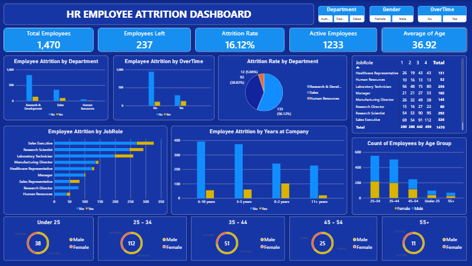

# HR Employee Attrition Analysis

## Project Overview
Analyzed employee attrition to identify workforce patterns
and factors associated with employee turnover.

## Tools Used
- Python: Pandas, Matplotlib
- Microsoft Excel: Pivot Tables and Charts
- SQL: Data analysis queries
- Power BI: Interactive HR dashboard

## Project Workflow
1. Cleaned and prepared the HR dataset using Pandas.
2. Created Excel pivot tables and visualizations.
3. Wrote SQL queries to analyze employee attrition.
4. Developed charts using Matplotlib.
5. Built a Power BI dashboard with KPI cards,
   department analysis, job role analysis, overtime
   analysis, tenure analysis, and age-group analysis.

## Key Dashboard Metrics
- Total Employees: 1,470
- Employees Left: 237
- Attrition Rate: 16.12%
- Active Employees: 1,233
- Average of Age: 36.92

## Dashboard Preview

## Project Outcome
Developed an HR analytics dashboard to help explore
employee attrition patterns and workforce trends.

